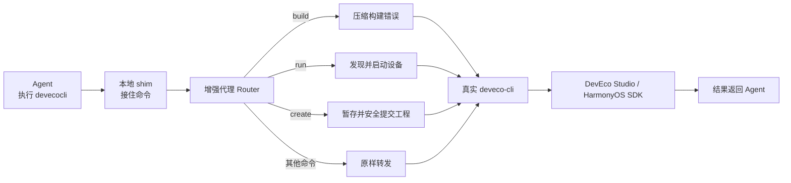

# DevEco CLI 代理架构方案

## 目标

Agent 上层统一使用标准 `devecocli` 命令。在原生 CLI 能力尚未完全覆盖现有内置工具期间，由 DevEco Code 的固定代码流程补齐差异，确保从 `build_project`、`start_app` 平移后能力不劣化。

## 架构

Agent 仍然执行标准 `devecocli` 命令。shim 将命令转交给 DevEco Code 的 Router；Router 对 `build`、`run` 做必要增强，其余命令不处理，最终都调用真实 `deveco-cli`。

## 组件职责

### shim

- 作为 DevEco Code Agent shell 中优先命中的 `devecocli` 入口。
- 将原始参数完整转交给 Router。
- 不包含设备发现、日志解析等业务逻辑。

### Router

- 由 DevEco Code 固定代码实现，不依赖 Skill 是否触发。
- `build`：调用真实 CLI，提取并压缩核心构建错误，保留完整日志和真实退出码。
- 普通 `run`：发现连接设备和停止的模拟器，必要时启动模拟器，再保留原始参数调用真实 CLI。
- `log`：未指定时间范围、`--tail`、`--follow` 或 `--crash` 时默认添加 `--tail 2000`。显式 `--tail` 仅要求正整数，不设置最大值。
- `log clear`：通过真实 CLI 的 JSON 设备列表将名称或序列号解析为唯一连接标识，再执行 HDC 清理。未指定设备时必须只有一个连接设备；空参数、歧义目标和发现失败均不执行清理。HDC 即使退出码为 0，只要输出包含失败信息，也保留错误原文并返回非零退出码。
- `create`：先在目标同级临时目录调用真实 CLI 完整生成工程。目标不存在或为空时通过目录重命名提交；显式 `--merge` 时保留已有内容，并在确认生成路径无冲突后以 no-clobber 方式逐文件合并。
- `docs search` / `docs read`：将超过 5000 字符的返回内容保存到临时文件，并在预览开头给出全文路径。提示和预览合计不超过 5000 字符，保留真实退出码；相同内容复用同一文件路径。
- 其他命令、特殊 `run` 模式和未知参数：原样转发给真实 CLI。

### 真实 deveco-cli

- 作为构建、安装、运行和设备操作的最终能力入口。
- 继续对接 DevEco Studio、HarmonyOS SDK、Hvigor、HDC 和模拟器。

## 设计边界

- 不在通用 shell 层解析或替换命令文本，Router 只处理已经解析好的参数数组。
- Router 内部通过绝对路径调用真实 CLI，避免再次命中 shim 造成递归。
- 不擅自改变 CLI 语义：`devecocli run` 仍表示构建并运行，只有显式传入 `--skip-build` 才跳过构建。
- 保留 `--product`、`--build-mode`、`--uninstall`、模块等全部原始参数。
- Skill 可以提供 Agent 行为指导，但不属于正确性依赖和主执行链路。
- 新流程通过契约测试确认与 `build_project`、`start_app` 行为等价后，再移除旧内置工具。

## 迁移阶段

第一阶段保留 `build_project`、`start_app`，用于对比新旧流程。Agent shell 中的标准 `devecocli` 命令先接入 Router，内置工具继续直接调用真实 CLI，避免重复增强。

移除旧工具前还需要迁移依赖 Tool 调用事件的构建统计，以及 `build_project` 基于 Session 状态提供的 `arkts_check` 提示。完成这些契约后，再修改 Agent Prompt 和 Tool Registry，正式切换到标准 CLI 命令。
