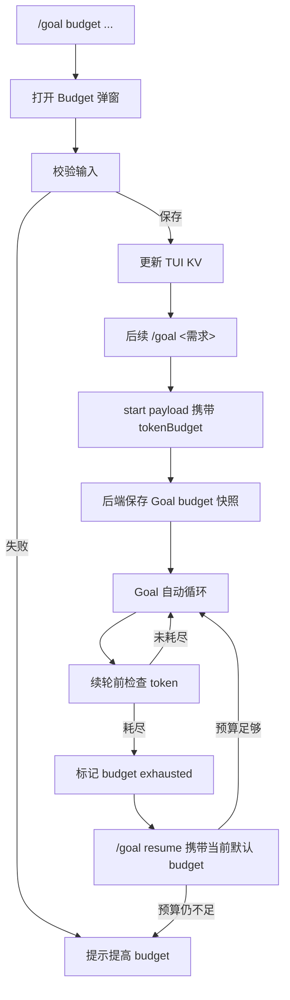

# Goal Token Budget 开发设计

## 1. 目标

为 Goal 模式增加可选的 token budget，限制 Goal 自动跨轮执行时的 token 消耗。

- 默认无上限。
- 用户通过 `/goal budget` 打开弹窗设置默认 budget。
- 用户随后通过 `/goal <需求>` 启动 Goal。
- Goal 启动时快照当前 budget，执行期间不随默认值变化。
- 前端负责配置和展示，后端负责校验、统计和停止自动续轮。

## 2. 产品规则

### 2.1 默认值

默认无上限，统一使用 `null` 表示：

```ts
export const DEFAULT_TOKEN_BUDGET: number | null = null
```

不使用 `0` 或负数表示无上限。

### 2.2 配置作用域

budget 是 TUI 用户级偏好，保存在 KV 中，可跨 Session 使用：

```ts
kv.get<number | null>("goal_token_budget", null)
```

规则：

- 用户未设置时为 `null`，即无上限。
- 弹窗保存后只更新默认 budget。
- 启动 Goal 时，将当前默认 budget 传给后端并写入 Goal。
- 已启动 Goal 使用自己的 budget 快照，不受后续默认值修改影响。
- 已耗尽 Goal 执行 `/goal resume` 时例外：TUI 会把当前默认 budget 传给后端；新值高于已用量或为 Unlimited 时，更新 Goal 快照并恢复执行。
- 替换 Goal 时重新快照当前默认 budget，并从零统计。
- 输入框留空并保存时恢复无上限。

### 2.3 Token 统计

首版沿用现有 `goalTokenUsage()` 口径：

```text
input + output + reasoning + cache.read + cache.write
```

只统计当前 Goal `sourceMessageID` 之后的 assistant 消息。

模型返回后才能获得本轮真实 token，因此最终用量可能超出 budget 一轮。后端必须在创建下一条自动 continuation message 前检查 budget，避免继续调用模型。

## 3. 用户交互

### 3.1 命令

```text
/goal budget [...]   打开预算弹窗，忽略后续内容
/goal <需求>         使用当前默认预算启动 Goal
```

`budget` 是保留关键字。只要 `/goal` 后第一个完整单词是 `budget`，就打开弹窗并忽略其余输入，不启动 Goal。

现有命令保持不变：

```text
/goal stop
/goal clear
/goal resume
```

预算耗尽后执行 `/goal resume`：

- 当前默认 budget 高于 Goal 已用量，或为 Unlimited：更新当前 Goal budget 并恢复执行。
- 当前默认 budget 仍不够：不恢复，并提示：

  ```text
  Goal budget exhausted. Increase it with /goal budget before resuming.
  ```

### 3.2 弹窗

```text
Goal Budget

Current: Unlimited

Budget: [____________]
Examples: 10000, 100k, 100K, 1.5m, 1.5M

[Cancel]  [Save]
```

规则：

- 打开弹窗时显示当前默认 budget。
- `/goal budget` 后面的内容不预填到输入框。
- 点击 Save 才更新 KV。
- 输入框留空时保存为 `null`，恢复 Unlimited。
- 点击 Cancel 不修改 budget。
- 打开弹窗后清空原 Prompt。
- 非法输入在弹窗中提示，不调用后端。

### 3.3 输入校验

允许：

```text
10000
100k
100K
1.5m
1.5M
```

规则：

- 纯整数按实际 token 数解释。
- `k/K` 乘以 1,000。
- `m/M` 乘以 1,000,000。
- 小数必须带 `k/K/m/M` 单位。
- 不允许空格、负数、`0`、科学计数法、逗号或额外字符。
- 解析结果必须为安全整数。
- 有效范围：`1,000` 至 `10,000,000`。

### 3.4 自动补全与帮助

自动补全增加：

```text
/goal budget    Configure the Goal token budget
```

`/goal` 帮助显示：

```text
Current budget: 100k tokens
Used: 32.4k tokens
```

没有活跃 Goal 时不显示 Used。

### 3.5 状态栏

设置上限时：

```text
Goal · active · 12m · 32.4k / 100k tokens
```

无上限时：

```text
Goal · active · 12m · 32.4k tokens · unlimited
```

预算耗尽时：

```text
Goal · budget exhausted · 100k / 100k tokens
```

预算耗尽时不显示 `paused`，也不显示百分比。

颜色可根据内部使用率变化，但状态栏不展示使用率数字：

- 低于 70%：正常色。
- 70% 至 90%：警告色。
- 超过 90%：错误色。

## 4. 命令解析

扩展命令类型：

```ts
export type GoalCommand =
  | { action: "help" }
  | { action: "stop" }
  | { action: "clear" }
  | { action: "resume" }
  | { action: "open_budget" }
  | { action: "start"; objective: string }
```

解析顺序：

1. 精确处理 `stop`、`clear`、`resume`。
2. 第一个完整单词为 `budget` 时返回 `open_budget`。
3. 其它非空参数作为 Goal objective。

```ts
const arguments_ = input.slice("/goal".length).trim()
const [command] = arguments_.split(/\s+/, 1)

if (command === "budget") {
  return { action: "open_budget" }
}
```

## 5. 数据模型

扩展后端 `SessionGoal.Info`：

```ts
type GoalInfo = {
  // 现有字段
  tokenBudget: number | null
  budgetExhaustedAt: number | null
}
```

- `tokenBudget` 是 Goal 启动时的 budget 快照。
- `budgetExhaustedAt` 用于标识预算耗尽，前端不依赖 `reason` 文本判断。
- 不持久化 `usedTokens`，避免与消息 token 数据形成双份状态。

## 6. API

复用现有路由：

```text
POST /session/:sessionID/goal
```

扩展 `start` payload：

```ts
type GoalStartPayload = {
  action: "start"
  objective: string
  tokenBudget?: number | null
  // 现有 agent、model、variant、parts
}

type GoalResumePayload = {
  action: "resume"
  tokenBudget?: number | null
}
```

规则：

- TUI 从 KV 读取 budget，并在启动 Goal 时传入 `tokenBudget`。
- 省略 `tokenBudget` 时后端按 `null` 处理。
- 后端校验 budget 必须是范围内的安全整数或 `null`。
- `stop`、`clear` 不接受 `tokenBudget`。
- `resume` 仅在预算耗尽时携带当前默认 `tokenBudget`；足够时更新 Goal 快照并恢复，不足时返回明确错误。

不新增独立预算设置 API。弹窗只更新 TUI KV；后端在 Goal 启动时保存快照，在耗尽后的 resume 成功时更新快照。

## 7. 后端执行控制

后端流程：

1. 启动或替换 Goal 时保存 `tokenBudget`，并清空 `budgetExhaustedAt`。
2. 每轮模型返回并持久化 token 后计算当前 Goal 用量。
3. 创建自动 continuation message 前比较 `usedTokens` 和 `tokenBudget`。
4. 达到或超过 budget 时停止自动续轮，将 Goal 标记为预算耗尽。
5. `/goal resume` 遇到预算耗尽状态时，使用请求中的新 budget 重新校验；足够时清除耗尽标记并恢复，不足时返回提示。

`tokenBudget === null` 时跳过预算检查。

预算耗尽的内部状态仍可使用 paused，但必须同时设置：

```ts
budgetExhaustedAt: Date.now()
reason: "token budget exhausted"
```

前端检测 `budgetExhaustedAt` 后显示 `budget exhausted`，不显示 paused。

普通运行中的 Goal 不受默认 budget 修改影响。预算耗尽后，用户提高默认 budget，再执行 `/goal resume`，后端会将新值应用到当前 Goal；修改 budget 本身不会自动恢复执行。

## 8. 前端数据流



## 9. 代码改动

后端：

- `packages/opencode/src/session/goal.ts`
  - 增加 budget 字段和预算判断。
- `packages/opencode/src/session/prompt.ts`
  - 自动续轮前检查预算。
- `packages/opencode/src/server/routes/instance/httpapi/groups/session.ts`
  - 扩展 Goal start Schema。
- `packages/opencode/src/server/routes/instance/httpapi/handlers/session.ts`
  - 启动 Goal 时写入 budget 快照。
- SDK 生成文件
  - 重新生成请求和响应类型。

TUI：

- `packages/tui/src/prompt/goal.ts`
  - 增加 `open_budget` 和 budget 解析。
- `packages/tui/src/component/prompt/autocomplete.tsx`
  - 增加 `/goal budget` 补全。
- `packages/tui/src/component/prompt/index.tsx`
  - 打开弹窗，并在启动 Goal 时附带 KV 中的 budget。
- `packages/tui/src/routes/session/dialog-goal-budget.tsx`
  - 新增单输入框弹窗。
- `packages/tui/src/routes/session/goal-status.tsx`
  - 展示 budget 和耗尽状态。

## 10. 测试

命令：

- `/goal budget` 返回 `open_budget`。
- `/goal budget 100k` 返回 `open_budget`，忽略 `100k`。
- `/goal budget 100k 实现需求` 返回 `open_budget`，忽略后续内容。
- 普通需求中间包含 `budget` 时仍启动 Goal。

输入：

- 正确解析整数、`k/K`、`m/M`。
- 拒绝空格、负数、零、无单位小数、科学计数法、逗号和额外字符。
- 拒绝超出范围或非安全整数。
- 空输入保存为 `null`。

弹窗：

- 显示当前默认 budget。
- 不使用 `/goal budget` 后续内容预填。
- 合法输入可以保存。
- 非法输入不能保存。
- Cancel 不修改 KV。

后端：

- 未传 budget 时无上限。
- 启动和替换 Goal 时正确保存快照并重新计数。
- 达到 budget 后不再创建 continuation。
- 无上限 Goal 不会因 token 使用量停止。
- `stop`、`clear` 不能修改 budget。
- 预算耗尽后，提高默认 budget 或恢复 Unlimited 可以通过 `/goal resume` 继续执行。
- 新 budget 仍不高于已用量时，`/goal resume` 被拒绝并显示正确提示。

状态栏：

- 显示 `used / budget tokens`，不显示百分比。
- 无上限时显示 `unlimited`。
- 预算耗尽时显示 `budget exhausted`，不显示 paused。

