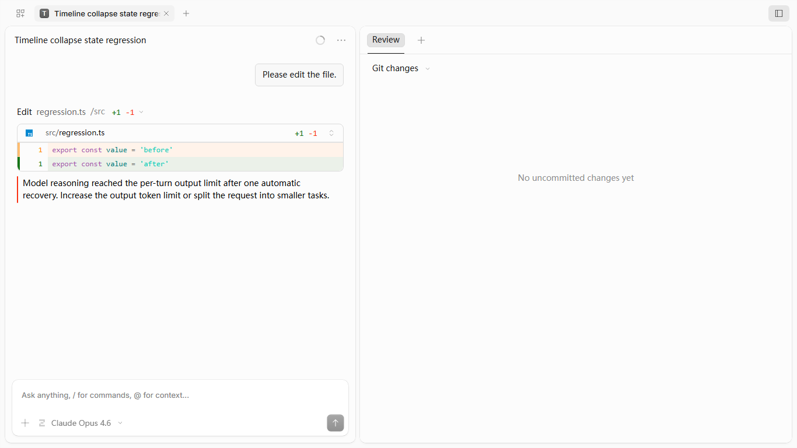

# 输出截断恢复：设计、测试与合入门禁

## develop 移植说明（2026-11-06）

- 从 `0a754ea15` 移入恢复实现，并采用 `ec761a6ed` 中的 Bun 工具副作用测试和产品协议 mock；创建路径的 JSON 断言已在 develop 中，不重复移入。
- 不移入原生 `arkts_check` 的注册断言，沿用 develop 当前的工具注册策略。
- `MessageOutputLengthError` 必须提供 `type`、`message`、`attempts`；`EmptyCompletionError` 必须提供 `message`、`type`、`attempts`、`cause`。不加入历史空错误数据的兼容逻辑。
- 按 SDK 构建脚本重新生成类型，仅保留本功能涉及的类型变更。
- 下文带日期的旧实测和旧二进制记录属于原修复的历史证据，不能代表这次 develop 移植的验证结果。

本次移植验证：

- Session 分类、prompt 和 schema：92 通过、15 跳过；processor、compaction、消息、retry、native LLM 和 CLI fixture 回归：250 通过、1 跳过。
- 真实源码 CLI：AI SDK/native × 恢复成功/再次截断，4 项通过，核对退出码、请求次数、持久化消息和 token 统计。
- OpenAI Chat 协议测试 28 项、错误提示测试 5 项、App timeline 单元测试 7 项通过。
- core、opencode、llm、app、tui、ui、sdk/js 的 `bun typecheck` 通过；SDK 生成脚本完成。
- 原分支未跟踪的 `packages/core/script/repro-pid-cleanup.ts` 依赖 develop 不存在的模块，验证时单独 stash 保存；该脚本不属于本次移植。
- 本次未重新构建后端发布二进制，源码 CLI 验收不代表发布产物验收。

恢复耗尽后的实际错误提示（生产 renderer，使用模拟消息）：



UI 生产构建性能场景使用相同参数：Chromium、30 倍 CPU 限速、320 个历史回合、160 个增量、每批 1 个事件。基线仅先补齐产品协议 mock，再构建未移植的 renderer。

| 指标                | 基线                             | 移植后                           |
| ------------------- | -------------------------------- | -------------------------------- |
| run ID              | `2026-11-06T01-48-31-564Z-11168` | `2026-11-06T01-53-08-059Z-19256` |
| 完成时间（ms）      | 211765                           | 187375                           |
| RAF 间隔 P95（ms）  | 749.9                            | 700.1                            |
| 已交付 / 待交付增量 | 160 / 0                          | 160 / 0                          |
| 行 / Markdown 重建  | false / false                    | false / false                    |
| 底部漂移 / 空白采样 | 0 / 0                            | 0 / 0                            |

两次场景均通过；单次测量不用于认定性能提升。

## 目标与边界

这次修复的目标是：provider 返回 `finish_reason=length` 时，不能把未完成任务当作成功结束；不是保证模型一定在下一轮完成任务，也不处理 provider 一直不结束的长时间 reasoning。

实际执行链为 `deveco run → HTTP Session handler → SessionPrompt → SessionProcessor → LLM`。`packages/core` 中的 V2 runner 尚未接管此入口。本次仅修复实际执行链，不修改 V2 runner，也不新增其恢复测试；CLI 验收不能由 V2 单测替代。

恢复策略及提示由 Session 自有的 `src/session/turn-recovery.ts` 管理，legacy prompt 保留调度流程；不扩展 V2 runner。core 的 V1 错误字段、事件错误类型和投影处理用于支持 legacy processor 的双写事件，保证终态及 token 数据一致。这些共享数据契约不代表修改 V2 runner。

行为约定：

- 每个真实用户活动最多进行一次 turn 恢复，`output_length` 与无可用输出的 `unknown` 共享额度；普通工具续跑不刷新额度，新用户输入刷新额度。
- 恢复前重读持久化历史，在对话尾部追加对应的 user 恢复提示；保留 reasoning、partial text、完成的工具结果及 token 统计。
- 不全局去重工具、不禁止再次使用同一工具；仅提示不要因为截断重做已完成工作。参数未完成的工具不应产生业务副作用，可以在恢复时重新调用。
- 再次截断或已用完 agent provider step 预算时，保留 `finish=length`，写入 `MessageOutputLengthError`（`data.type=output_length`、`attempts`、`cause`），发布 session error。仅有 reasoning 时 `cause=reasoning_limit`，已有正文或其他可用输出时 `cause=output_limit`；CLI 通过现有错误消费链退出 1。
- `attempts` 表示当前 activity 已经使用的统一恢复额度，首次即预算耗尽为 0；此前因 `unknown` 使用过恢复额度后再遇到 length 也为 1。压缩内部请求不是 agent 工作步骤。
- 恢复提示及额度穿过压缩、自动继续和输入溢出重建；压缩文本自身被 length 截断时明确失败，不将其视为有效检查点。
- 不提高输出上限、不调整 reasoning effort，不伪造签名或 encrypted reasoning。
- 不设计跨进程崩溃恢复。对已落盘的终态再次调用 loop 不会重新获得自动重试额度。
- 用户侧终态提示保持为一行，并按症状区分：超长思考建议提高单次输出上限或拆分任务；正文截断建议输入“继续”；`unknown` 无可用输出按响应意外中断提示，不推断为超长思考。

## 便宜、确定性的验收顺序

| 层级       | 入口与注入方式                                        | 验收内容                                                                            | 是否必须               |
| ---------- | ----------------------------------------------------- | ----------------------------------------------------------------------------------- | ---------------------- |
| 状态机集成 | SessionPrompt + 真实 Processor/LLM + 本机 HTTP SSE    | 恢复次数、历史、工具副作用、压缩、预算、中断、错误事件                              | 每次修改               |
| CLI 源码   | 独立 `bun src/index.ts run` 子进程 + 同一本机 SSE     | 路由确实到达实际 runner；stdout、stderr、退出码；退出后由测试进程只读打开文件数据库 | 每次修改               |
| 发布产物   | 同一 CLI 用例，通过 `DEVECO_TEST_BINARY` 指向构建结果 | 防止源码修好但打包产物/实际运行入口未包含修复                                       | 发包前                 |
| 负对照     | 相同用例指向修复前二进制                              | 必须因只请求一次/错误退出 0 而失败，不能因为启动失败而失败                          | 首次验收、改测试框架时 |
| 兼容回归   | Processor、compaction、message、retry、native adapter | 正常 stop/tool loop/provider error/协议转换不回归                                   | 合入前                 |
| 真实模型   | 可选单个固定任务                                      | 检查真实网关兼容性和任务效果，不承担触发 length 的唯一责任                          | 上述关卡通过后按需     |

本地 SSE 直接发送短 reasoning 加 `finish_reason=length`，无需真的生成 32k token；usage 可声明 32000 以验证统计保留。这验证控制流与协议解析，不验证模型在真实长上下文上的推理质量。

## 必查场景

`packages/opencode/test/session/turn-recovery.test.ts` 中 `output length recovery` 用例（与原 prompt 测试共用 `test/fixture/session-prompt.ts`）：

| 场景                  | 必须成立的不变量                                                                      |
| --------------------- | ------------------------------------------------------------------------------------- |
| partial text          | 文本与 reasoning 留在历史；恢复请求带旧文本和恢复 user 提示                           |
| 连续两次 length       | 恰好两次 agent 请求；一次 Retried；Ended 在同一 V2 message 的 Failed 之前；usage 不丢 |
| 最后一个允许步骤      | 仅一次请求，attempts=0，不额外恢复                                                    |
| length 携带完成的工具 | 实际 bash 写入计数文件仅一行；恢复请求有工具结果；无重复执行                          |
| 工具参数被截断        | 不执行不完整业务命令；下一轮可重新调用，最终副作用仅一次                              |
| 自动压缩              | length → checkpoint → 恢复；提示仍在，第二次 length 失败而不是第三次恢复              |
| 压缩与两步预算        | 压缩不会吞掉唯一恢复额度；恢复仍算一个 agent 工作步骤                                 |
| 恢复请求输入溢出      | length → 被拒请求 → checkpoint → 重建请求；额度不刷新                                 |
| 压缩输出也截断        | 拒绝不完整 checkpoint，无后续自动请求                                                 |
| 恢复中 provider error | 保留 APIError，不伪装为 length，也不追加第三次请求                                    |
| 恢复中 interrupt      | 通过请求到达信号同步取消；保留 AbortedError，无后续请求                               |
| 新用户活动            | 前一活动失败后，下一活动重新获得一次恢复额度                                          |
| 结构化输出            | length 优先于“缺失结构化结果”判定，恢复完成后输出合法结果                             |
| 已终止活动再次 loop   | 返回原终态，不再次请求 provider                                                       |

另有执行中接收新输入的用例：等待第二次请求到达，再插入新输入；验证同一 loop 内新活动重新获得恢复额度和步骤预算，且第一条新请求不携带旧活动的恢复提示。

CLI 用例为 AI SDK / native transport × 恢复成功 / 连续截断，共 4 个。显式断言 `runner=legacy` 及 `llm.runtime`，避免“测试实际悄悄走了另一条链”。

其中 OpenAI-compatible（GLM 使用的现有路径）必须在第二次真实 HTTP 请求中带回 `reasoning_content`。native 用例验证恢复控制流及 reasoning 落盘，但其既有 lowering 未在本用例中回放纯 reasoning 文本；不将其宣称为所有协议都能原样回放。Responses 的 encrypted/signature 合法性沿用已有 adapter 测试，未扩大此次转换层修改。

## 测试隔离与证据

- 测试 provider 指向本机随机端口，仅使用虚构 API key；固定标题，避免标题请求污染调用次数。
- 临时 HOME/XDG/config/workspace 隔离，禁用插件发现、模型列表抓取、自动更新；配置目录预置仓库本地 plugin 依赖及 lock，阻止 Config 的后台 npm 安装。
- CLI fixture 显式设置临时文件 `DEVECO_DB`，避免继承单测 preload 的 `:memory:`。CLI 退出后，测试进程以只读连接读取 message/part 表；进程内历史或仅有 SSE 输出不能满足此断言。
- 每条用例检查 provider 请求数及剩余 fixture response 数。不能用自动返回的兜底 `ok` 当通过。
- 工具验收检查文件实际内容，不只检查工具事件数量。
- 中断测试等待 `llm.wait(2)`，不靠 sleep 猜请求是否已经发出。
- `run` 显式开 `--print-logs`；源码/产物使用相同用例。`DEVECO_TEST_EXPORT=1` 额外检查 export，发包验收开启该项。
- `DEVECO_TEST_ARTIFACTS` 输出每例 JSON，包含执行文件、请求次数、耗时、stdout/stderr 和退出码。`stage=run_finished` 仅表示 run 返回，不能当整条测试通过；所有断言通过后才写 `stage=passed`，并附落盘 assistant 数据。这些都是模拟任务日志，不含真实模型凭证。

## 命令

从 `packages/opencode` 运行快速功能验收：

```sh
bun test test/session/turn-recovery.test.ts test/session/finish-outcome.test.ts
bun test test/cli/run/output-length.test.ts
bun typecheck
```

合入回归（仍在 `packages/opencode`）：

```sh
bun test test/session/prompt.test.ts test/session/turn-recovery.test.ts test/session/finish-outcome.test.ts test/session/processor.test.ts test/session/processor-effect.test.ts test/session/compaction.test.ts test/session/message-v2.test.ts test/session/retry.test.ts test/session/session-schema.test.ts test/session/llm-native.test.ts test/cli/run/run-process.test.ts test/cli/run/output-length.test.ts test/lib/cli-process.test.ts --only-failures
```

从 `packages/core`：

```sh
bun typecheck
```

公开 schema 变化后，从仓库根目录执行 `./packages/sdk/js/script/build.ts`。生成器可能暴露既有未同步 API；本次仅保留 output-length 相关类型变化，不夹带其他接口更新。

发布验收示例（在 `packages/opencode`，二进制路径和日志目录均使用绝对路径）：

```sh
bun run script/build.ts --single --skip-install --skip-embed-web-ui --skip-agreement
DEVECO_TEST_BINARY=/absolute/path/to/deveco DEVECO_TEST_EXPORT=1 DEVECO_TEST_ARTIFACTS=/absolute/path/to/artifacts bun test test/cli/run/output-length.test.ts
shasum -a 256 /absolute/path/to/deveco
```

上述构建跳过协议 UI 与 web UI，用于后端 CLI smoke；正式发布应按常规构建参数生成产物，再将同一套测试指向正式产物。测试不应以“编译成功”代替运行产物验收。

## 维测日志怎么判断

启动标记：`message="session runner" runner=legacy turnRecovery=v1 recoveryLimit=1`。

恢复相关记录统一使用 `message=turn_recovery`，并通过 `reason=output_length|empty_unknown` 区分触发原因：

- `phase=retry`：已观测 length，批准一次恢复；`attempt=1`。
- `phase=resume`：开始恢复 provider turn。
- `phase=recovered`：恢复 turn 返回非 length，**不代表整个工程任务成功**，仍需结合 finish、后续工具和最终结果。
- `phase=compact`：恢复 turn 遇到输入溢出，待压缩重建。
- `phase=stopped`：恢复 turn 因既有错误处理停止。
- `phase=failed`：恢复耗尽或 `cause=step_limit`；终态必须有 session error。

用 `session.id`、`activityID`、`messageID` 关联；截断记录还包含 provider/model、loop step/providerStep、attempt、finish、tokens、compaction、hasText、hasToolCall。日志不记录 reasoning、用户原文、工具参数或密钥。

“包含修复”和“本次触发并恢复”是不同结论：只有启动标记只能证明此执行链启用了策略；`retry → resume` 加最终正常结果才证明此次成功恢复；`retry → resume → failed` 表示防止假成功生效，但任务未完成。

## 发给 benchmark 同事的最小证据包

1. 二进制绝对路径、`--version`、SHA-256、构建基线 commit/补丁标识。
2. 指向同一 SHA-256 二进制的 4 条 CLI 验收结果；不能只给源码单测结果。
3. benchmark 使用 `--print-logs`，收集 stdout/stderr、命令退出码及 session export。
4. 核对本轮终态，不得仅搜索曾经出现过 `output_length`；成功恢复后最终助手没有 terminal error。
5. 未自然触发 length 的 benchmark 只能说明任务回归通过，不能否定或证明恢复分支。

无需为了碰到随机 length 反复跑整套 benchmark。确定性关卡全部通过后，真实模型最多做一次针对性 smoke；失败先按入口/产物/恢复阶段定位，再决定是否重跑。

## 额外发现，不能算成已解决

源码模式的 `export` 在重复子进程验收时偶发卡在配置初始化，30 秒超时；日志停在配置路径加载阶段。预置本地 npm 依赖后仍观测到，尚未定位根因，不能声称为 length 修复的一部分。已测试的发布二进制 export 用例通过。

因此默认长度恢复门禁使用真实 CLI 加独立文件数据库读取，不通过删除持久化断言或放大超时来让测试通过。export 作为独立可选门禁保留（发包时开启），后续若要修源码 export 初始化，应单独定位并回归；此次不扩大生产代码修改范围。

## 收敛后实测（2026-09-04）

- V2 runner 和其测试文件与首次修复前的基线完全一致，已用 git diff 核验；不修改提交历史。
- legacy length 专项 14/14、真实源码 CLI 4/4 通过。
- core/opencode 的 `bun typecheck` 通过，`git diff --check` 通过。
- 本次没有重新构建二进制或跑 benchmark。保留原有完整测试方案，发包前对新构建执行产物门禁。

## 收敛前实测记录（2026-09-04，不能代替收敛后验收）

- length 专项 14 个用例通过；最后的 legacy prompt 文件全量 73 通过、1 跳过。
- 相关 11 文件回归 336 通过、2 跳过、0 失败；之后新增的执行中接收新输入用例单独及随 prompt 全量验证通过。
- 收敛前 V2 runner 97/97 通过；该恢复实现、测试及两处顺带修正的 Location 夹具现已撤回，此结果不再作为当前补丁的验收依据。
- 源码 CLI 4/4，通过真实文件数据库核验；最终构建产物 CLI 4/4，额外 export 核验也通过。首次 usage 按 reasoning=31940、其他输出=60 验证保留。
- core/opencode 类型检查通过，SDK 按脚本重新生成，仅保留本特性相关变更。
- 旧二进制负对照 2/2 **按预期失败**：都只发一次请求、退出 0，没有任何恢复阶段日志。
- 本轮未调用真实模型、未重新跑长 benchmark。

本地产物证据在 `tmp/output-length-acceptance/`：`manifest.json` 记录版本/SHA-256，`source/`、`binary/`、`negative-control/` 保存模拟运行证据。旧 dist 已移至 `pre-fix-dist/` 保留，未删除。最终二进制版本 `0.0.0-feat/20260813-202609040747`，SHA-256 为 `b5823aa57c498ebce414de977166e71299fce536a9d832f5f728f1fae532abfe`；构建包含本地未提交补丁，不能用基线 commit 单独代表产物内容。

上述二进制在范围收敛前构建，不能代表当前源码；发包前需要重新构建并执行产物验收。
